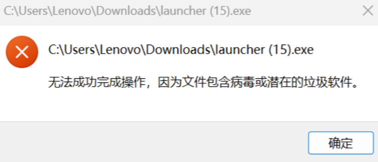

# Unicore 常见问题

汇总 Unicore 使用中的常见问题与解决方法。安装步骤请先阅读 [Unicore 开启教程](/unicore/start)。

## 一、如果出现 F2 无反应情况（两个地方需要检查）

### 1. 关闭内核隔离 / 内存完整性

打开 **设置 → WINDOWS 安全中心 → 设备安全性 → 内核隔离 → 详细信息**，进去之后看一下，是不是有个灰色的关不上（如果有，请**关闭内存完整性并重启电脑**，即可关闭）。

### 2. 卸载残留的杀毒软件

打开 **控制面板 → 卸载程序 → 搜索 ant**（如果有请一定要卸载，否则 F2 无反应）。

## 二、如果 F2 直接蓝屏 / 黑屏 / launcher 消失 / 电脑重启 / 游戏闪退

如果出现下面这种提示：

解决方法：打开 **设置 → WINDOWS 安全中心 → 病毒和威胁防护 → 管理设置 → 实时保护**，把它**关闭**即可，再**重新下载 launcher** 即可恢复（每次重启电脑，实时保护都会自己打开）。

---

## 三、如果您遇到了以下问题

请参考 [开启教程](/unicore/start) 里的加速器说明，挂上魔法重新下载即可恢复。

## 四、我后续应该如何续费？

请查看 [Unicore 续费教程](/unicore/renew)。

## 五、我应该如何暂停时间消耗？

请查看 [Unicore 暂停时间教程](/unicore/pause)。

本教程版权归 LBW 教程网所有，抄袭必究。检测到此文字说明该网站为盗版。
