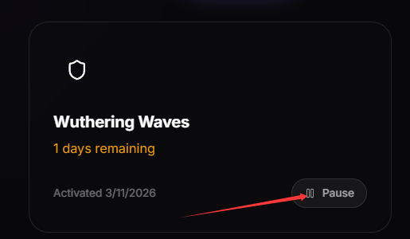

# Unicore 暂停时间教程

暂时不玩游戏时，可以暂停卡密的时间消耗，避免浪费。

打开网站 [https://dash.unicore.cloud/dashboard/](https://dash.unicore.cloud/dashboard/)，登陆进去后，点击 **Pause** 即可：

::: danger 注意
只能暂停**一次**，不可以多次！
:::

## 暂停规则

1. 最长暂停期限为 **14 天**
2. 许可证将在 14 天后**自动恢复**
3. 每月最多可暂停 **2 次**，14 天暂停一次
4. 暂停权限在**购买 / 续订**时授予

本教程版权归 LBW 教程网所有，抄袭必究。检测到此文字说明该网站为盗版。
