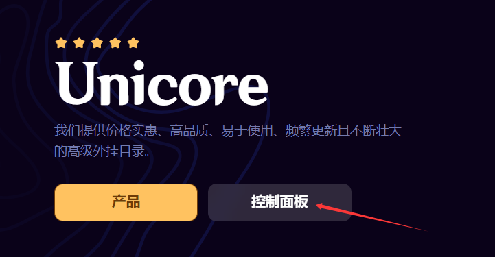
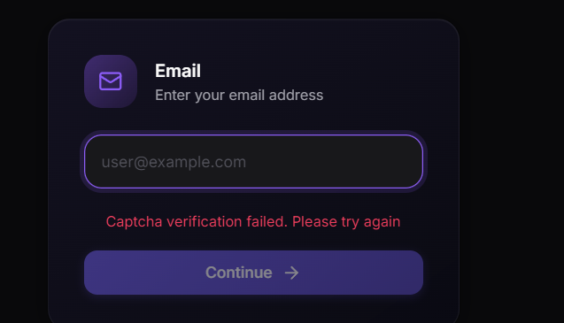
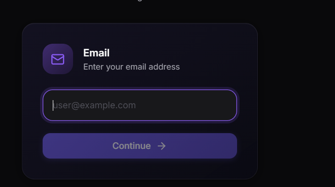
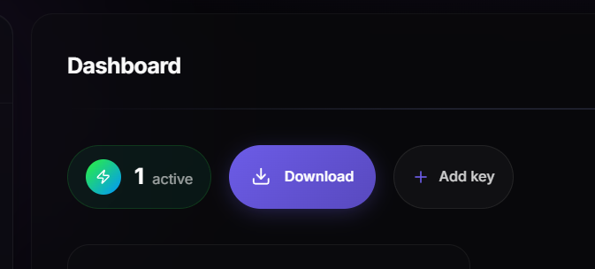
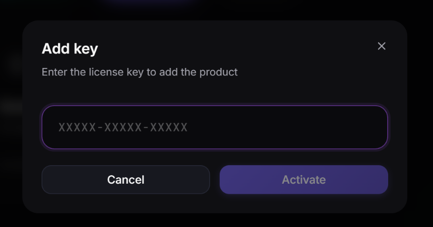
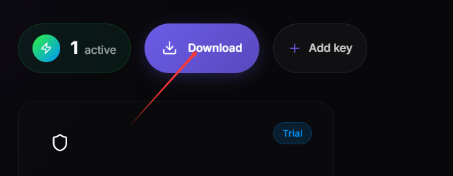

# Unicore 续费教程

已购买过 Unicore 的用户，按本页教程续费添加新的时间。

::: warning 注意
如果后续**更换电脑**，必须更换一个**新的邮箱**，不能使用以前的邮箱，否则会报错。
:::

**卡网：** [https://www.lbwsir.cc.cd/](https://www.lbwsir.cc.cd/)

## 添加教程

请先进入该网址：[https://unicore.cloud/zh](https://unicore.cloud/zh)（打不开请参考 [开启教程](/unicore/start) 里的加速器说明）

进入官网后，点击右上角 **控制面板**：

如果出现下面这个报错，请参考 [开启教程](/unicore/start) 里的加速器说明，挂上加速器后刷新浏览器就好了：

点击控制面板后会出现邮箱登陆，这里**任意邮箱都可以**，没有要求（如果收不到验证码请看邮箱垃圾桶，肯定在里面）：

进入仪表盘，点击 **Add key**：

输入密钥并点击 **Activate（激活）**：

激活密钥后，点击 **Download** 按钮下载启动器（如果下载速度 / 载入非常慢，请挂上加速器，会快很多！）：

::: tip 提示
**不需要重新下载软件**，只需要重新打开软件即可。
:::

本教程版权归 LBW 教程网所有，抄袭必究。检测到此文字说明该网站为盗版。
