# Unicore 开启教程

教程将引导你完成 Unicore 的杀毒软件关闭、账户注册、密钥激活、启动器下载与游戏注入。适用于原神、星穹铁道、鸣潮等所有支持的游戏。

::: info 提示
在开始之前，你需要有一张 Key（卡密），否则无法下载软件。如果您已经购买则不需要再次购买。
:::

::: tip 嫌麻烦？
如果您觉得难 / 麻烦 / 不想弄，可直接来这里拍 [远程代装](https://www.lbwsir.cc.cd/)，我们会直接帮您全程弄好。
:::

> 🦄 所有第一次购买的用户，可享受本店优惠，2 天卡仅需 25 元即可！

## 一、关闭电脑当中的杀毒软件

先下载这个地址，按照视频关闭杀毒：[https://wwbof.lanzn.com/iVcf43givydg](https://wwbof.lanzn.com/iVcf43givydg)

部分杀毒软件可能是英文菜单，没有汉化，可以查看这个网址对照：[英文菜单对照图](https://pic1.imgdb.cn/item/68ff05153203f7be00a5abfe.jpg)

## 二、开启教程

请先进入该网址：[https://dash.unicore.cloud/dashboard](https://dash.unicore.cloud/dashboard)

如果出现报错 / 点不动情况，如：

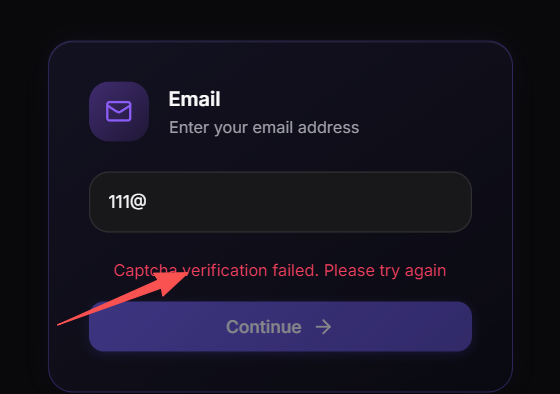

请按照教程，挂好加速器，随后回来刷新浏览器即可。[腐竹专属加速器](https://mcnus97vmbjz.feishu.cn/wiki/JgVcwvCUkiYhjrkNG63cyd5U)（如果提示风险，请重新进）。

### 第一步：注册账户

这里**任意邮箱都可以**，没有要求（如果收不到验证码，请看邮箱的**垃圾桶**，肯定在里面）。

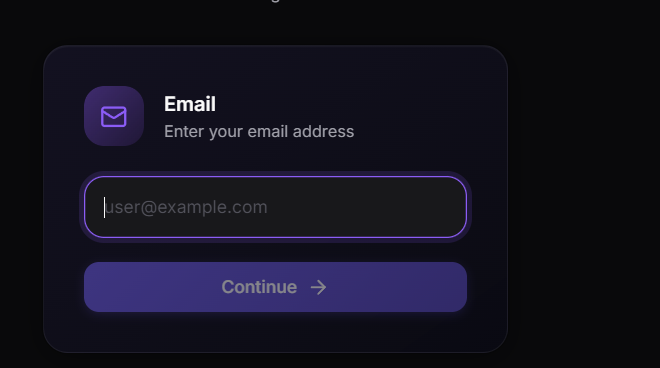

### 第二步：激活密钥

1. 进入仪表盘，点击 **Add key**。

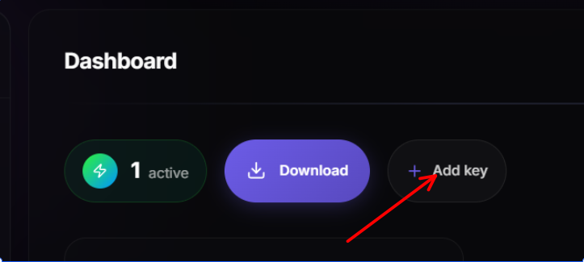

2. 输入密钥并点击 **Activate（激活）**。

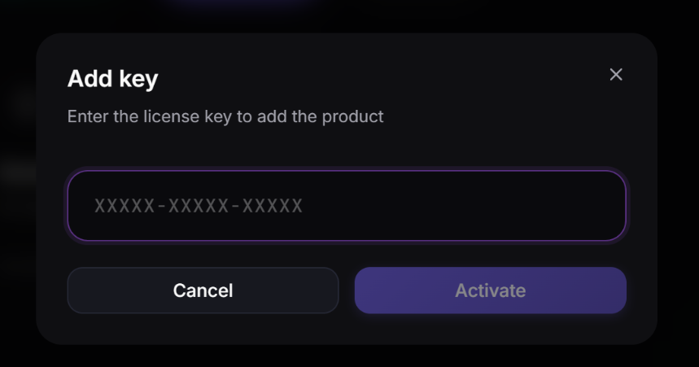

### 第三步：下载启动器

密钥激活后，点击 **Download** 按钮下载启动器（如果下载速度 / 载入非常慢，请挂上加速器，会快很多！）。

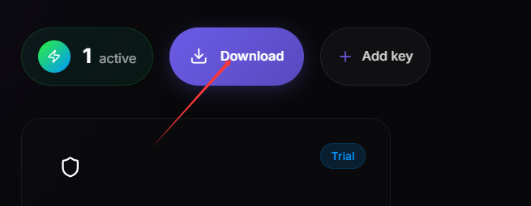

如果您在下载后出现了下面这个提示，请**右键保留**，随后点开右侧的小箭头，仍然选择**保留**即可。

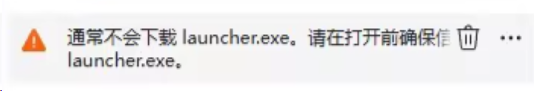

### 第四步：启动与注入

**（1）** 下载好 launcher 后，启动 launcher（如果双击后无反应，请打开加速器的**系统代理**和**虚拟网卡**，等待 30 秒即可打开）。

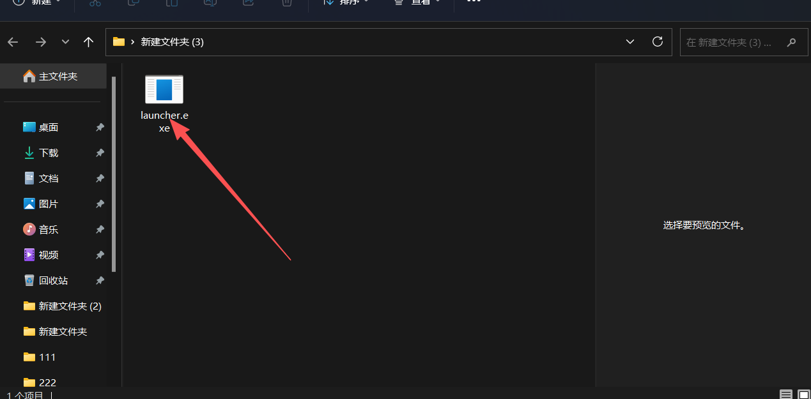

**（2）** 等待几秒钟后，会出现这个面板，自动加载，一般在 1-5 秒内加载完毕。

**（3）** 选择你购买的游戏并点击图标，随后点击开始按钮即可。

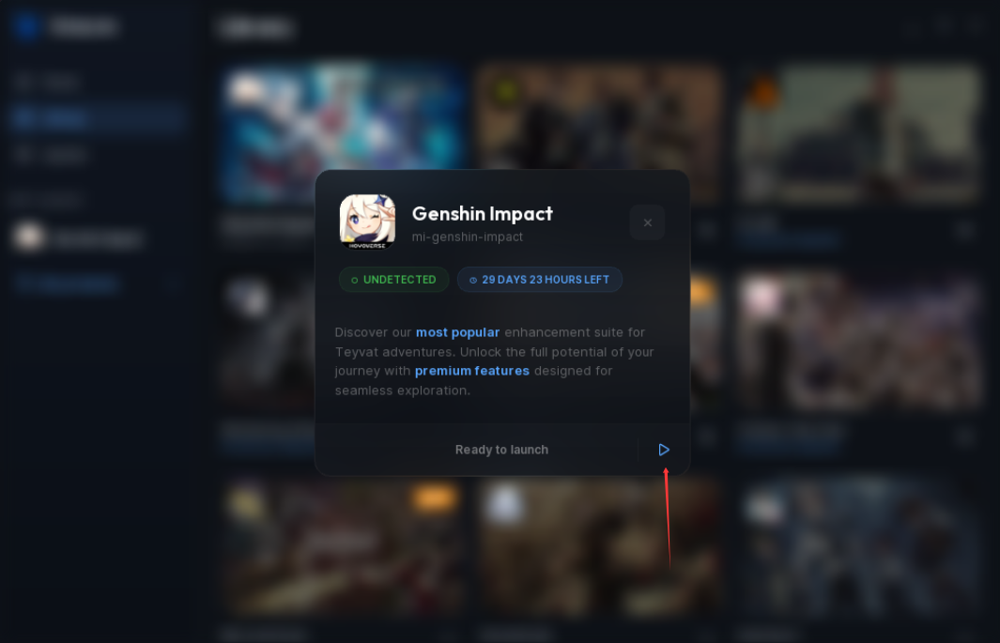

如果剩余时间跟自己买的不一样**不用在意**，因为国内和国外计算方式不一样，时间是够的。

**（4）** 按一下三角（播放键）就会开始载入，等待完成即可。

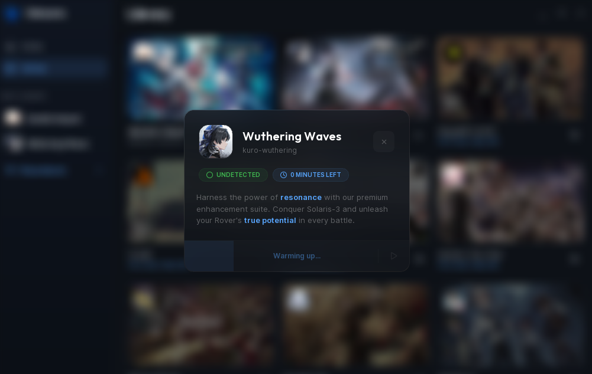

::: warning 插入说明
加载完成后，软件可能会闪退，出现一个黑色面板随机立刻消失。如果出现黑色面板后电脑卡顿属于**正常现象**，基本发生在 Win11 24H2 版本，待电脑恢复速度后继续操作即可，也可以手动降级 Win10 彻底解决它。

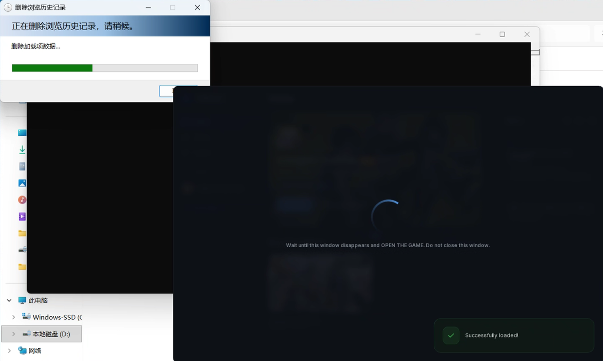
:::

**（5）** 启动启动器，然后进入游戏。

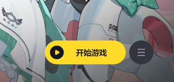

**（6）** 然后按一下 **F2** 键位，界面就会出现，如下图（如果 F2 没有任何反应 / 电脑重启 / 黑屏 / 闪退，请看 [常见问题](/unicore/faq)；也有可能是 **FN + F2** 键位）。

出现面板后，可以在右上角**小齿轮**处修改语言设置，如下图。默认为 **INS** 键关闭面板。

**（7）传送教程：** 点击传送门菜单，随后点击 **Entities** 单词，点进去之后，把**常规**打开，右面把**宝藏**勾选，然后点一下那个 **Teleport** 就可以传送了。右键那个英文单词可以设置快捷键。

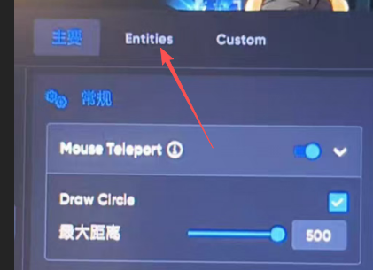

::: danger ❗ 重要（S 级）
**F2 只用于注入！** 启动成功后，请按 **INS** 进行菜单的关闭及打开操作。

正常情况下，按这个（INS 键）关闭和打开面板。如果找不到，请联系技术支持。

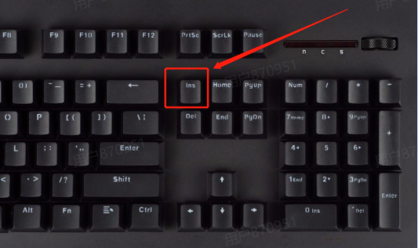
:::

本教程版权归 LBW 教程网所有，抄袭必究。检测到此文字说明该网站为盗版。
